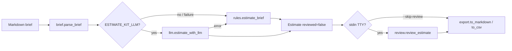

# Architecture

estimate-kit is a small CLI pipeline: parse a Markdown brief → produce three-point hour ranges → force a human review → export Markdown or CSV.

## ADR 1 — Rules file is the source of hours

**Decision:** All default categories, modifiers, risks and assumptions live in `rules.toml`.

**Why:** Readers can audit every number without reading Python. Tests and the README quote the same file.

**Trade-off:** Keyword matching is crude; a wrong category is a data problem, not a code path.

## ADR 2 — Review is mandatory by default

**Decision:** The CLI walks every task (`accept` / `edit` / `drop`) before export unless `--skip-review` is passed.

**Why:** The product promise is that a person must look at the draft. Unreviewed output keeps an explicit status line.

**Trade-off:** Non-interactive CI must opt out. Non-TTY stdin without `--skip-review` exits 2.

## ADR 3 — LLM behind an env flag with versioned prompts

**Decision:** `ESTIMATE_KIT_LLM=1` enables an OpenAI-compatible chat call using `prompts/v1/`. Failures fall back to rules.

**Why:** Offline use stays the default. Prompt packs are versioned so past runs remain reproducible.

**Trade-off:** Live provider behaviour is not exercised in CI; only parsing and config are unit-tested with a fake `post_chat`.

## ADR 4 — PERT totals with root-sum-of-squares spread

**Decision:** Per-task expected = `(b + 4l + w) / 6`, spread = `(w − b) / 6`. Totals add expected values and combine spreads as √Σs², then clamp to the sum of bests / worsts.

**Why:** Naive sums of worst cases overstate joint risk; a single point estimate hides uncertainty.

**Trade-off:** Independence is assumed, so the "plausible range" is optimistic. Documented in README and on the Pages calculator.

## ADR 5 — Static Pages site, no app server

**Decision:** `site/` is plain HTML/CSS/JS with a client-side range calculator and a brief→output example.

**Why:** Zero host cost, works on GitHub Pages, mirrors the CLI math for teaching.

**Trade-off:** The site does not run the Python parser; the example output is a curated excerpt.
